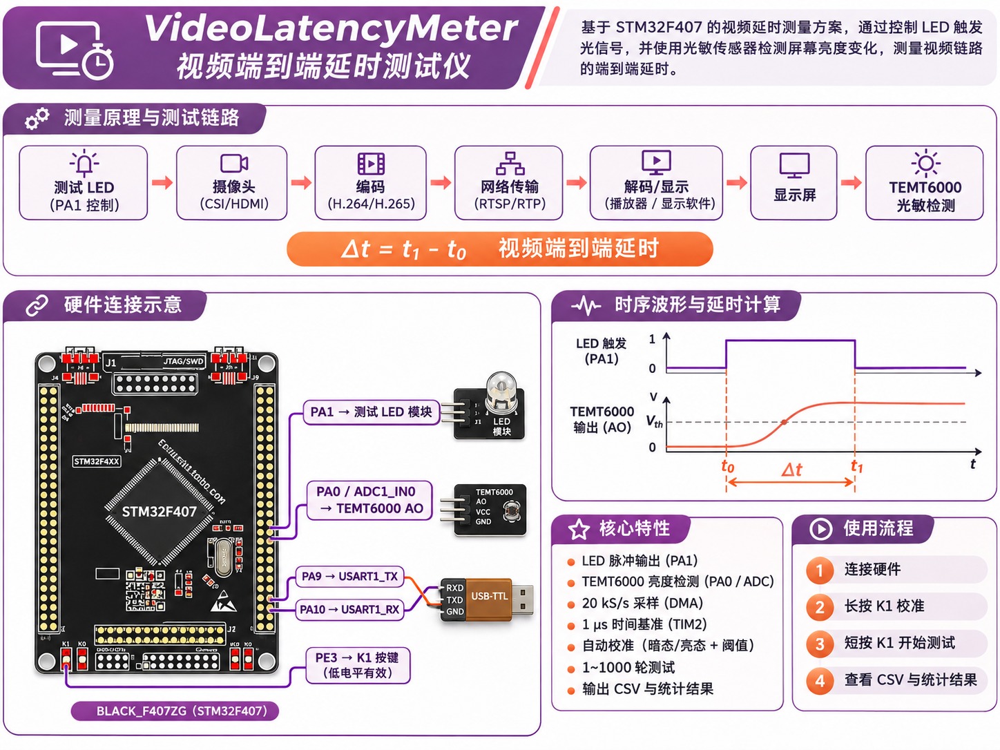
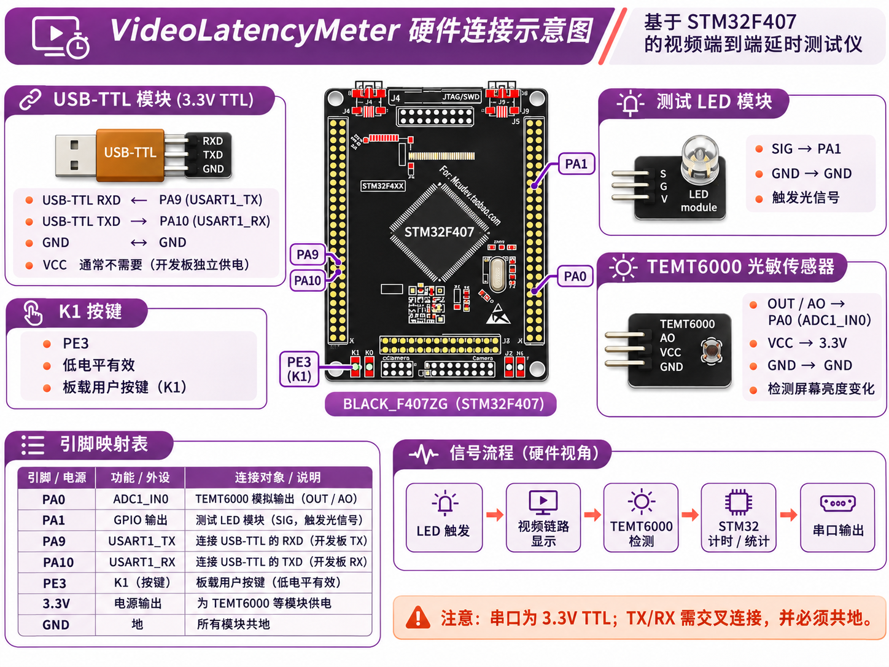
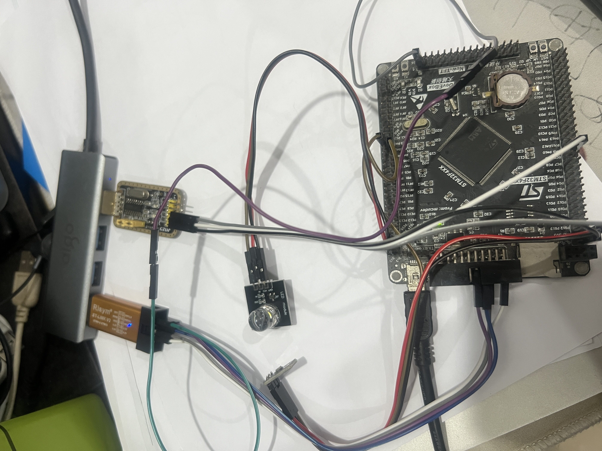
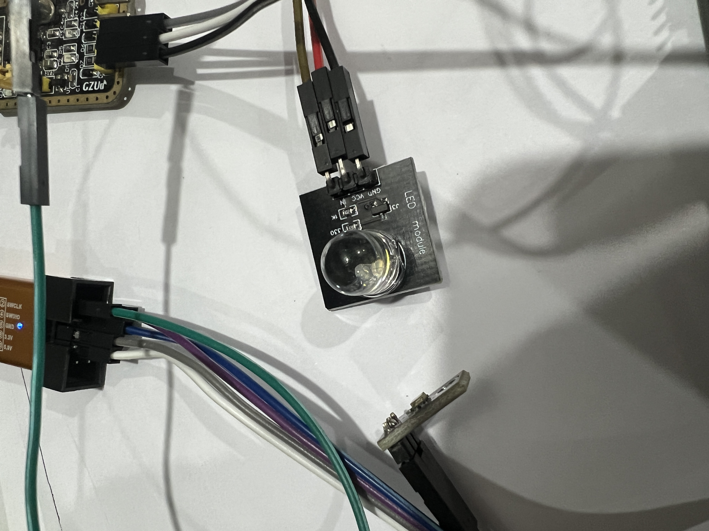

# VideoLatencyMeter

English | [简体中文](README.zh-CN.md)

Firmware for an STM32F407-based end-to-end video-latency meter.



*Figure 1. The G2G test chain. PA1 drives the LED stimulus (`t0`); the video
path transports the event to the display; TEMT6000 detects the display rise at
`t1`; the reported latency is `t1 - t0`.*
## Measurement concept: glass-to-glass video latency

This project measures a **glass-to-glass (G2G)**-style video path: an optical
event is created in the source camera's field of view and the matching optical
event is detected on the receiving display. The path under test is:

```text
PA1 electrical trigger → LED → source camera / first "glass" →
capture + ISP + encode + transport + decode → receiving display / second "glass" →
TEMT6000 sensor
```

For each round, the STM32 records `t0` when PA1 changes state, then records
`t1` when the display sensor crosses the calibrated rising threshold. The
reported latency is `t1 - t0`. It includes the tested video chain and display
response, as well as the LED and sensor response.

Strict laboratory G2G defines the start at the **actual light event at the
camera input**, rather than at a GPIO transition. This design is therefore best
described as an electrical-trigger-referenced G2G measurement. For absolute
G2G work, either calibrate the PA1-to-LED optical delay and subtract it, or add
a second fast optical sensor at the source to timestamp the LED emission.

G2G must not be confused with **GtG (gray-to-gray)**, which is a display-panel
pixel-transition specification. GtG measures only the panel's response between
two grey levels; this instrument measures the complete camera-to-display path.

## Features

- PA1 LED stimulus output.
- TEMT6000 analogue light sensing through PA0 / ADC1_IN0.
- TIM3-triggered ADC sampling at 20 kS/s with DMA.
- TIM2 1 MHz microsecond timebase.
- Automatic dark/bright calibration and threshold generation.
- Batches of 1 to 1000 rounds with CSV records and min/mean/median/P95/P99/max/
  standard-deviation statistics.
- USART1 diagnostics and traditional serial control commands.

## System overview and hardware



*Figure 2. Hardware connections. PA1 controls the test LED, PA0 receives the
TEMT6000 analogue output, PA9/PA10 provide the 3.3 V TTL serial link, and K1
on PE3 starts, calibrates, or cancels a measurement.*

### Assembled hardware




*Figure 3. Photographs of the assembled prototype. Confirm the actual board
silkscreen and connector pinout before wiring; the diagrams describe the
firmware pin assignment, not a guarantee of every board revision's headers.*

## Wiring

| STM32 pin | Role | Connection |
| --- | --- | --- |
| PA0 | ADC1_IN0 | TEMT6000 AO / SIG |
| PA1 | GPIO output | Test LED or LED-driver input |
| PA9 | USART1_TX | USB-TTL adapter RXD |
| PA10 | USART1_RX | USB-TTL adapter TXD |
| PE3 | K1, active low | On-board push button |
| 3.3 V | Sensor supply | TEMT6000 VCC |
| GND | Common ground | TEMT6000 GND, USB-TTL GND, debugger GND |
| SWDIO / SWCLK / NRST | Debug/programming | ST-Link or J-Link |

The serial port uses **3.3 V TTL**, not DB9/RS-232. Cross TX and RX, and share
ground:

```text
USB-TTL RXD  <--- PA9  (USART1_TX)
USB-TTL TXD  ---> PA10 (USART1_RX)
USB-TTL GND  ----- GND

TEMT6000 AO  ----> PA0
TEMT6000 VCC ----> 3.3 V
TEMT6000 GND ----> GND
```

The sensor analogue output must stay within the MCU analogue-reference range
(normally 0 to 3.3 V). When the board is powered separately, normally leave
the USB-TTL adapter VCC disconnected.

## Button and normal use

K1 is connected to PE3 and is active low.

| Action | Result |
| --- | --- |
| Short press and release | Start a measurement batch with the configured default count; automatically calibrate first when no valid calibration exists |
| Hold for 2 seconds | Calibrate only; do not start a batch |
| Press while measuring or calibrating | Cancel the current operation; a short press takes effect on release, while a held key takes effect at the 2-second event |

The key is debounced for 30 ms. A long-press event is generated after 2 seconds
while the key remains down; it does not generate an additional short-press
event when released. When the meter is idle, the event selects either test or
calibration. When it is busy, either event is interpreted only as **cancel**.

## Default measurement parameters

All parameters below are RAM-only and return to their defaults after reset or
power-off. Use `config` on the serial console to display the active values.

| Parameter | Default | Behaviour |
| --- | --- | --- |
| Default batch size | 30 rounds | Used by a K1 short press and by `start` without a round count |
| Permitted batch size | 1 to 1000 rounds | Use `start N` for one batch, or `config rounds N` to change the K1/default size |
| ADC sample rate | 20,000 samples/s | One nominal sample every 50 µs |
| LED pulse width | 200 ms | PA1 stays on for this fixed time each round |
| Detection timeout | 1000 ms | Starts at the PA1 trigger; a missed rising edge becomes `TIMEOUT` |
| LED-off recovery | pseudo-random 500 to 1500 ms | Reduces fixed timing relationships between successive rounds |
| Dark-screen timeout | 3000 ms | The batch aborts if the display does not return below the falling threshold |
| Edge confirmation | 3 consecutive samples | Rejects a single noisy threshold crossing |
| Saved waveform | 64 samples | `wave` exports the samples around the latest detected edge |

Calibration defaults are: LED off settle for 100 ms, collect dark data for
200 ms, LED on settle for 1000 ms, then collect bright data for 200 ms. Thus a
normal calibration takes about 1.5 seconds before any following batch begins.
The automatic rising threshold is 50% of the measured dark-to-bright contrast;
the falling threshold is 25%, providing hysteresis. Calibration fails instead
of testing when contrast is too small relative to measured noise.

While idle, the persistent-for-this-boot settings can be changed with:

```text
config rounds 1..1000
config pulse 20..1000
config timeout 100..5000
config recovery <min_ms> <max_ms>    (100..10000, min <= max)
config threshold auto
config threshold <rise_adc> <fall_adc>
```

Manual thresholds require a successful calibration and must remain between the
calibrated dark and bright levels. Settings cannot be changed while calibration
or a test batch is running.

Recommended workflow:

1. Place the LED in the camera view of the video path under test. Aim the
   TEMT6000 at the corresponding bright area on the receiving display.
2. Keep ambient lighting, display brightness, camera exposure, and sensor
   position stable. The sensor must not see the LED directly.
3. Hold K1 to calibrate. This records dark and bright levels and generates the
   detection thresholds.
4. Short-press K1 to start the measurement. Each round confirms that the
   display is dark, turns on the LED, then detects the display rising edge.
5. View the per-round `CSV` records and final statistics in the serial terminal.
   CSV timestamps and latency values are always in microseconds (`us`).

UART settings: **115200 baud, 8 data bits, no parity, 1 stop bit, no flow
control (115200 8-N-1)**.

Traditional serial commands are available for diagnostics: `help`, `status`,
`calibrate`, `start [rounds]`, `stop`, `stats`, `config`, `sensor`, `wave`,
`led on`, and `led off`.

## Build environment

The project uses GNU Arm Embedded Toolchain and `mingw32-make`; STM32CubeIDE is
not required.

| Tool | Default script location / requirement |
| --- | --- |
| GNU Arm Embedded Toolchain | `E:\Program Files\GNU Arm Embedded Toolchain\xpack-arm-none-eabi-gcc-15.2.1-1.1\bin` |
| MinGW Make | `mingw32-make.exe` must be available on `PATH` |
| STM32CubeProgrammer | `E:\Program Files\STMicroelectronics\STM32Cube\STM32CubeProgrammer` |

If the compiler is installed elsewhere, change `TOOLCHAIN_BIN` in
[build.bat](build.bat):

```bat
set "TOOLCHAIN_BIN=E:\Program Files\GNU Arm Embedded Toolchain\xpack-arm-none-eabi-gcc-15.2.1-1.1\bin"
```

`build.bat` adds that directory to its own `PATH`; a permanent system
environment-variable change is unnecessary. `mingw32-make.exe` must be on the
caller PATH. For a PowerShell session, for example:

```powershell
$env:Path = "E:\Program Files\MinGW\bin;$env:Path"
where.exe mingw32-make
```

## Build

Recommended command:

```powershell
.\build.bat
```

The script cleans old output and uses `%NUMBER_OF_PROCESSORS%` parallel jobs.
To choose a fixed job count manually:

```powershell
$env:Path = "E:\Program Files\GNU Arm Embedded Toolchain\xpack-arm-none-eabi-gcc-15.2.1-1.1\bin;$env:Path"
mingw32-make clean
mingw32-make -j8 all
```

Build output is written to `build/`:

```text
VideoLatencyMeter.elf    debug image
VideoLatencyMeter.hex    ST-Link / DFU programming image
VideoLatencyMeter.bin    raw binary image
VideoLatencyMeter.map    linker map
```

## Programming

### SWD: ST-Link or J-Link

Connect target power, GND, SWDIO, and SWCLK; connect NRST when possible. Run:

```powershell
.\flash_stlink.bat
```

The script builds, programs, and verifies the firmware. It first tries a
hardware-reset connection and falls back to Hot Plug. In the current board
setup, Hot Plug cannot reset the target; press RESET or power-cycle the board
after a successful fallback flash.

### USB DFU

Set `BOOT0` to 3.3 V, keep `BOOT1` at GND, and reset the board. Once Windows
shows `STM32 BOOTLOADER`, run:

```powershell
.\flash_dfu.bat
```

Return BOOT0 to GND and reset the board after programming.

## Measurement scope

The nominal ADC rate is 20 kS/s, so adjacent samples are approximately 50 µs
apart. The TIM2 timestamp resolution is 1 µs, but this does not imply 1 µs
absolute system accuracy. LED turn-on delay, the sensor module, display refresh
and backlight, camera exposure, the video chain, and ambient light all affect
the outcome.

The reported result is defined as the time from the **PA1 electrical transition**
to the sensor's detected display-threshold crossing. Use a fixed geometry and
consistent display and environmental conditions when comparing video systems.

## Third-party code

`third_party/STM32CubeF4-min` is the STM32CubeF4 CMSIS/HAL snapshot required
for offline builds. Preserve its licence and attribution files when
redistributing this repository.
