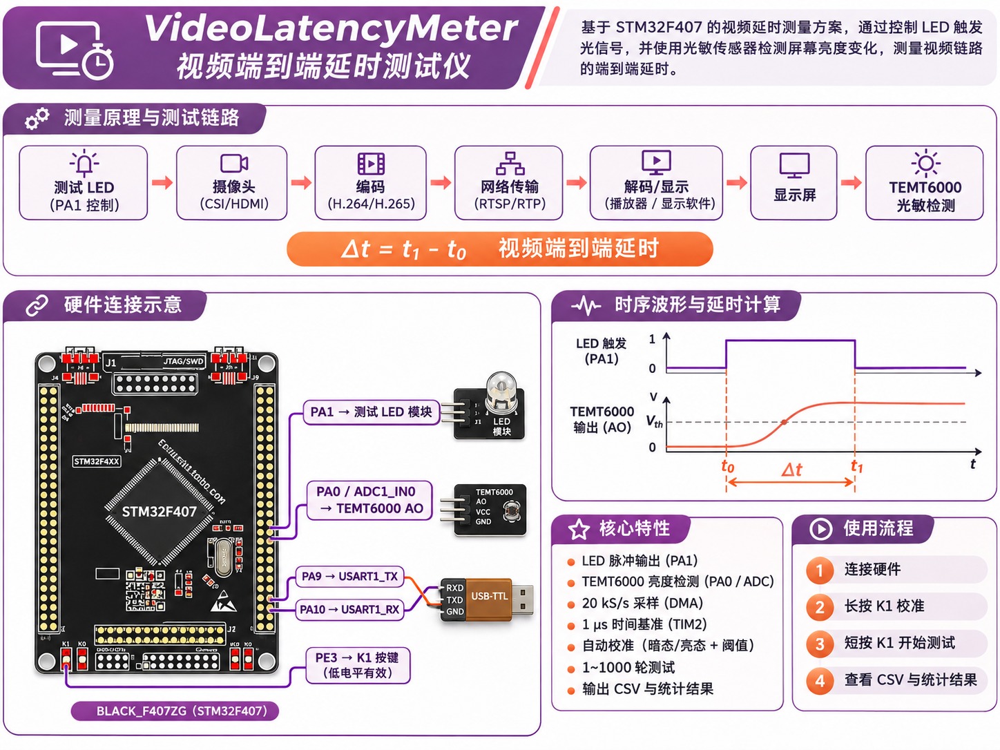
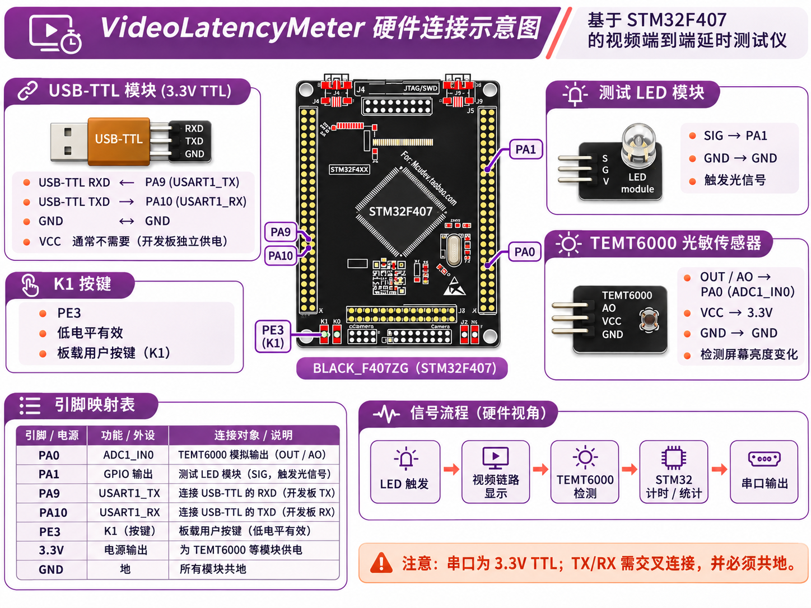
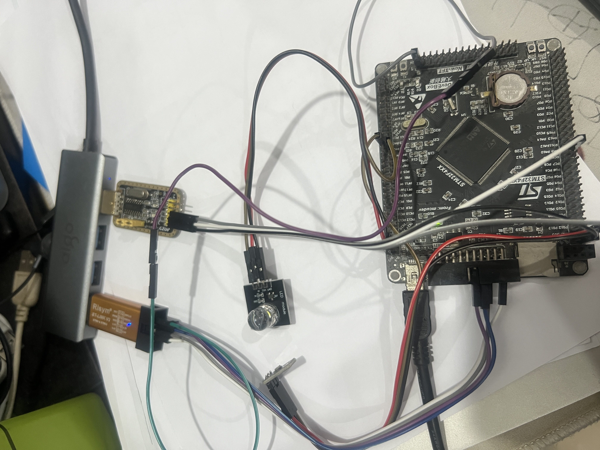
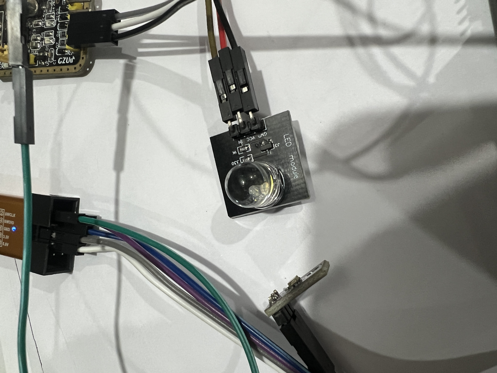

# VideoLatencyMeter

[English](README.md) | 简体中文

基于 STM32F407 的视频端到端延时测试仪固件。

## 整体方案：Glass-to-Glass（G2G）视频延时

本项目测量的是 **Glass-to-Glass（G2G，镜头到屏幕）** 风格的视频链路延时：在发送端摄像头视野中产生一个光学事件，并在接收端显示器上检测同一事件对应的亮度变化。被测链路为：

```text
PA1 电气触发 → LED → 源端摄像头 / 第一个“Glass” →
采集 + ISP + 编码 + 传输 + 解码 → 接收端显示器 / 第二个“Glass” →
TEMT6000 光敏传感器
```

每一轮中，STM32 在 PA1 翻转时记录 `t0`；传感器检测到显示器亮度越过校准上升阈值时记录 `t1`；结果为 `t1 - t0`。该结果包含被测视频链路与显示器响应，也包含 LED 和传感器自身的响应时间。

严格定义的 G2G，起点应是**摄像头输入端实际发生的光学事件**，而非 GPIO 翻转。因此，当前设计更准确地说是“以电气触发为基准的 G2G 测量”。若需要绝对 G2G 值，应先标定并扣除 PA1 到 LED 实际发光的延时，或在源端增加第二个高速光学传感器，对 LED 发光时刻单独打点。

不要将 G2G 与 **GtG（gray-to-gray，灰阶响应时间）** 混淆。GtG 是显示面板从一个灰阶切换到另一个灰阶的像素响应指标；本项目测量的是完整的摄像头到显示器视频链路。

## 功能概览

- PA1 输出 LED 测试脉冲。
- PA0 / ADC1_IN0 采集 TEMT6000 模拟亮度信号。
- TIM3 触发 ADC，以 20 kS/s 通过 DMA 连续采样。
- TIM2 提供 1 MHz 微秒时间基准。
- 自动采集暗态/亮态数据，生成检测阈值。
- 支持 1 至 1000 轮测试，输出单轮 CSV 数据和最小值、平均值、中位数、P95、P99、最大值、标准差。
- USART1 输出日志和接收传统串口命令。

## 整体架构与硬件实物



*图 1：G2G 测试链路。PA1 驱动 LED 光刺激并记录 `t0`；视频链路将该事件传递到显示器；TEMT6000 在 `t1` 检测到屏幕亮度上升；最终结果为 `t1 - t0`。*



*图 2：硬件连接关系。PA1 控制测试 LED，PA0 接收 TEMT6000 模拟输出，PA9/PA10 提供 3.3V TTL 串口，PE3 上的 K1 用于启动、校准或取消测量。*

### 已连接的硬件实物




*图 3：当前原型实物照片。接线前仍应以实际开发板丝印和接口定义为准；图示说明的是固件使用的引脚分配，不能替代不同开发板版本的实际接口核对。*

## 硬件连接

| STM32 引脚 | 用途 | 外部连接 |
| --- | --- | --- |
| PA0 | ADC1_IN0 | TEMT6000 AO / SIG |
| PA1 | GPIO 输出 | 测试 LED 或 LED 驱动输入 |
| PA9 | USART1_TX | USB-TTL 的 RXD |
| PA10 | USART1_RX | USB-TTL 的 TXD |
| PE3 | K1，低电平有效 | 板载按键 |
| 3.3V | 传感器供电 | TEMT6000 VCC |
| GND | 共地 | TEMT6000 GND、USB-TTL GND、调试器 GND |
| SWDIO / SWCLK / NRST | 调试与烧写 | ST-Link 或 J-Link |

串口是 **3.3V TTL 电平**，不是 DB9/RS-232。TX/RX 要交叉连接，并必须共地：

```text
USB-TTL RXD  <--- PA9  (USART1_TX)
USB-TTL TXD  ---> PA10 (USART1_RX)
USB-TTL GND  ----- GND

TEMT6000 AO  ----> PA0
TEMT6000 VCC ----> 3.3V
TEMT6000 GND ----> GND
```

TEMT6000 的模拟输出不得超过 MCU 的模拟参考电压范围（通常为 0 至 3.3V）。开发板独立供电时，通常无需连接 USB-TTL 的 VCC。

## 按键与使用方法

K1 接在 PE3，按下为低电平。

| 操作 | 作用 |
| --- | --- |
| 短按并释放 K1 | 使用当前默认轮数开始测量；尚未校准时会先自动校准 |
| 持续按住 2 秒 | 仅执行校准，不开始测量 |
| 测量或校准中按 K1 | 取消当前操作；短按会在释放时生效，持续按住会在达到 2 秒时生效 |

按键消抖时间为 30 ms。长按事件在按键持续按下满 2 秒时立即产生，松开后不会再额外产生短按事件。设备空闲时，按键事件用于选择“测试”或“仅校准”；设备忙碌时，任何按键事件都只会被解释为**取消**。

## 默认测量参数

以下参数仅保存在 RAM 中，复位或断电后恢复默认值。串口输入 `config` 可查看当前生效配置。

| 参数 | 默认值 | 行为 |
| --- | --- | --- |
| 默认测试轮数 | 30 轮 | K1 短按和不带轮数的 `start` 都使用该值 |
| 可设置轮数 | 1 至 1000 轮 | `start N` 仅设置本次测试；`config rounds N` 修改 K1/默认轮数 |
| ADC 采样率 | 20,000 samples/s | 标称每 50 µs 一个样本 |
| LED 点亮时间 | 200 ms | 每轮中 PA1 固定保持点亮的时间 |
| 检测超时 | 1000 ms | 从 PA1 触发开始计时；未检测到上升沿时该轮标为 `TIMEOUT` |
| LED 熄灭恢复间隔 | 伪随机 500 至 1500 ms | 避免每一轮都处于固定时间相位 |
| 屏幕回暗超时 | 3000 ms | 显示器未回到低于下降阈值时，中止本批测试 |
| 边沿确认 | 连续 3 个样本 | 避免单个噪声样本误触发 |
| 保存波形 | 64 个样本 | `wave` 导出最近一次检测边沿附近的采样点 |

校准默认流程为：LED 熄灭后稳定 100 ms，采集暗态 200 ms；LED 点亮后稳定 1000 ms，采集亮态 200 ms。因此，在开始后续测试前，正常校准约需 1.5 秒。自动上升阈值为暗态到亮态对比度的 50%，下降阈值为 25%，从而形成迟滞。若对比度相对噪声过小，校准会失败而不会开始测试。

设备空闲时可通过以下传统串口命令修改本次上电期间的配置：

```text
config rounds 1..1000
config pulse 20..1000
config timeout 100..5000
config recovery <min_ms> <max_ms>    (100..10000，min <= max)
config threshold auto
config threshold <rise_adc> <fall_adc>
```

手动阈值必须先完成校准，且必须位于校准得到的暗态和亮态范围内。校准或测试运行期间不能修改参数。

推荐测试流程：

1. 将 LED 放在被测视频链路的拍摄区域；将 TEMT6000 对准接收端显示器上对应的亮点区域。
2. 固定环境光、显示亮度、相机曝光和传感器位置，避免传感器直接看到 LED。
3. 上电后，先用 K1 长按进行校准。校准会记录暗态和亮态，并自动生成检测阈值。
4. 短按 K1 开始测试。每轮先确认屏幕已经恢复暗态，再点亮 LED 并检测屏幕亮度上升沿。
5. 在串口终端查看每轮 `CSV` 行及最终统计结果。CSV 内的时间与延时单位固定为微秒（`us`）。

串口参数：**115200，8 数据位，无校验，1 停止位（115200 8N1），无流控**。

传统串口命令可用于辅助调试：`help`、`status`、`calibrate`、`start [轮数]`、`stop`、`stats`、`config`、`sensor`、`wave`、`led on`、`led off`。

## 编译环境

项目使用 GNU Arm Embedded Toolchain 与 `mingw32-make`，不依赖 STM32CubeIDE。

| 工具 | 默认位置 / 要求 |
| --- | --- |
| GNU Arm Embedded Toolchain | `E:\Program Files\GNU Arm Embedded Toolchain\xpack-arm-none-eabi-gcc-15.2.1-1.1\bin` |
| MinGW Make | `mingw32-make.exe` 必须在 `PATH` 中 |
| STM32CubeProgrammer | `E:\Program Files\STMicroelectronics\STM32Cube\STM32CubeProgrammer` |

如 ARM GCC 安装在其他位置，只需修改 [build.bat](build.bat) 的 `TOOLCHAIN_BIN`：

```bat
set "TOOLCHAIN_BIN=E:\Program Files\GNU Arm Embedded Toolchain\xpack-arm-none-eabi-gcc-15.2.1-1.1\bin"
```

`build.bat` 会临时将该目录加入自身的 `PATH`，无需永久修改系统环境变量。`mingw32-make.exe` 则需要可从 `PATH` 找到，例如当前 PowerShell 会话可执行：

```powershell
$env:Path = "E:\Program Files\MinGW\bin;$env:Path"
where.exe mingw32-make
```

## 编译

推荐直接执行：

```powershell
.\build.bat
```

脚本会先清理旧文件，再根据 `%NUMBER_OF_PROCESSORS%` 使用当前电脑的逻辑处理器数量并行编译。

也可以手动构建：

```powershell
$env:Path = "E:\Program Files\GNU Arm Embedded Toolchain\xpack-arm-none-eabi-gcc-15.2.1-1.1\bin;$env:Path"
mingw32-make clean
mingw32-make -j8 all
```

输出文件位于 `build/`：

```text
VideoLatencyMeter.elf    调试镜像
VideoLatencyMeter.hex    ST-Link / DFU 烧写文件
VideoLatencyMeter.bin    原始二进制文件
VideoLatencyMeter.map    链接映射文件
```

## 烧写

### ST-Link / J-Link（SWD）

连接目标板电源、GND、SWDIO、SWCLK；有条件时同时连接 NRST。执行：

```powershell
.\flash_stlink.bat
```

脚本会编译、写入并校验固件。它先尝试硬件复位连接；若失败则自动改用 Hot Plug。当前板卡的 Hot Plug 模式不能自动复位，烧写校验成功后请手动按 RESET 或重新上电。

### USB DFU

将 `BOOT0` 拉高至 3.3V，`BOOT1` 保持 GND，随后复位。Windows 识别出 `STM32 BOOTLOADER` 后执行：

```powershell
.\flash_dfu.bat
```

烧写完成后将 BOOT0 拉回 GND，再手动复位。

## 测量说明

ADC 标称采样率为 20 kS/s，相邻样本间隔约 50 µs。TIM2 的时间戳分辨率为 1 µs，但这不等同于整套测试系统具有 1 µs 的绝对精度：结果还受到 LED 发光延迟、TEMT6000 模块响应、显示器刷新与背光、相机自动曝光、视频链路和环境光的影响。

结果的定义是：**PA1 电气翻转时刻到传感器检测到屏幕亮度阈值越过时刻的延时**。比较不同视频系统时，应保持 LED/传感器几何位置、显示参数和环境条件一致。

## 第三方代码

`third_party/STM32CubeF4-min` 是离线构建所需的 STM32CubeF4 CMSIS/HAL 源码快照。重新分发时请保留其中的许可证与归属文件。
